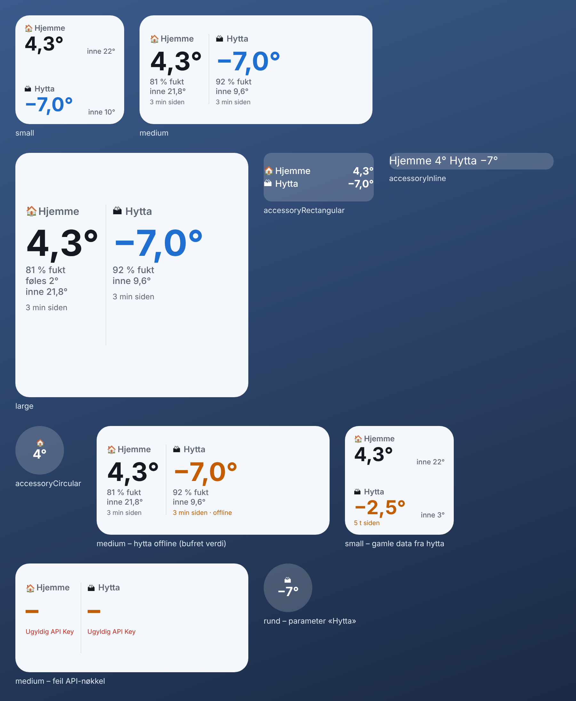

# Temp-widget – temperatur hjemme og på hytta

En widget for iPhone som viser temperaturen fra Ecowitt-stasjonene hjemme og på hytta,
rett på hjemskjermen (og låseskjermen hvis du vil).



*Bildet er en omtrentlig forhåndsvisning laget på PC. På iPhone blir skrift og ikoner
iOS sine egne, og widgeten følger lys/mørk modus.*

## Hva den viser

- **Stor temperatur** fra utesensoren på hver stasjon (blå under 0°, oransje over 25°).
- **Inne-temperatur**, slik at du ser om varmen står på på hytta.
- **Luftfuktighet** og **hvor gammel målingen er** på middels og stor widget.
- **Oransje tekst** hvis en stasjon ikke har sendt data på over 1,5 time, eller ikke svarer.
  Da vises siste kjente verdi i stedet for en tom widget.
- Trykk på widgeten for å åpne en større oversikt.

## Hvorfor Scriptable og ikke en «ekte» app?

Widgeten kjører i den gratis appen **Scriptable** fra App Store. Det gjør at den kan
installeres rett på telefonen hans uten Mac og uten utviklerkonto hos Apple.
En egenutviklet app krever Xcode på en Mac, og uten betalt utviklerkonto (ca. 1000 kr/år)
slutter den å virke etter 7 dager og må installeres på nytt.

---

## Oppsett (ca. 10 minutter)

### 1. Hent nøkler fra ecowitt.net

Ecowitt-appen lagrer målingene på ecowitt.net. Widgeten henter dem derfra med to nøkler.

1. Gå til **[ecowitt.net](https://www.ecowitt.net)** (gjerne på en PC) og logg inn med
   **samme e-post og passord som i Ecowitt-appen**.
2. Trykk på profilikonet øverst til høyre → **Private Center**.
3. Under **Application Key**: trykk *Create Key* (navn f.eks. «Widget»). Kopier nøkkelen.
4. Under **API Key**: trykk *Create Key*. Kopier nøkkelen.

Ta vare på begge til steg 4. Nøklene gir bare lesetilgang til målingene.

### 2. Installer Scriptable

Last ned **Scriptable** (av Simon B. Støvring) fra App Store. Den er gratis.

### 3. Legg inn scriptet

Velg én av måtene:

- **Kopier og lim inn:** Åpne [`TempWidget.js`](TempWidget.js) her på GitHub, trykk
  *Copy raw file*, og send teksten til telefonen hans (f.eks. via Notater eller e-post).
  Åpne Scriptable → trykk **+** øverst til høyre → lim inn alt → trykk på tittelen øverst
  og gi scriptet navnet **Temp** → *Ferdig*.
- **Som fil:** Last ned `TempWidget.js`, gi den nytt navn til `Temp.js` og legg den i
  mappen **iCloud Drive → Scriptable** (via Filer-appen eller AirDrop til Filer).
  Den dukker da opp i Scriptable automatisk.

### 4. Kjør scriptet én gang

Trykk på **Temp** i Scriptable. Den spør om:

1. **Application Key** og **API Key** fra steg 1 → lim inn → *Lagre*.
2. **Hver stasjon** den finner på kontoen → gi den et kort navn (f.eks. **Hjemme** og
   **Hytta**) og trykk *Vis*.
3. **Hvilken som skal stå først.**

Deretter får du en meny der du kan se hvordan widgeten blir i ulike størrelser.
Nøklene lagres i iPhonens nøkkelring, ikke i selve scriptet.

### 5. Legg widgeten på hjemskjermen

1. Hold fingeren på et tomt sted på hjemskjermen til ikonene vibrerer → **Rediger** →
   **Legg til widget**.
2. Søk etter **Scriptable**, velg **liten** eller **middels** størrelse → *Legg til widget*.
3. Trykk på den nye (tomme) widgeten mens ikonene fortsatt vibrerer:
   - **Script:** velg **Temp**
   - **When Interacting:** la stå som den er
4. Trykk utenfor. Etter noen sekunder vises temperaturene.

### Låseskjermen (valgfritt)

Hold inne låseskjermen → **Tilpass** → **Låseskjerm** → trykk på widgetfeltet under klokka →
velg Scriptable. Den **rektangulære** viser begge stasjonene, den **runde** viser én.
Velg *Temp* som script på samme måte som over.

### Vise bare én stasjon

Skriv navnet på stasjonen (f.eks. `Hytta`) i feltet **Parameter** når du redigerer
widgeten. Fint for den runde låseskjerm-widgeten, eller for å ha to små widgeter ved
siden av hverandre.

---

## Feilsøking

| Widgeten viser | Hva det betyr / gjør |
| --- | --- |
| «Ikke satt opp» | Scriptet er ikke kjørt i appen ennå. Gjør steg 4. |
| «Ugyldig Application Key» / «Ugyldig API Key» | Nøkkelen er feil eller slettet. Åpne Temp i Scriptable → *Endre Ecowitt-nøkler*. |
| «Ukjent stasjon (MAC/IMEI)» | Stasjonen er fjernet eller byttet. Åpne Temp → *Velg / gi navn til stasjoner*. |
| Oransje tekst «x t siden» | Stasjonen har ikke sendt data på en stund (strøm eller nett nede på hytta?). |
| «· offline» | Ecowitt svarte ikke nå; viser siste kjente verdi. |
| Oppdaterer sjelden | iOS bestemmer hvor ofte widgeter oppdateres, typisk hvert 15.–30. minutt. Trykk på widgeten for ferske tall. |

Innstillinger som hvor fort data regnes som gamle og fargegrensene står øverst i
`TempWidget.js` under `SETTINGS`.

## Utvikling

`dev/simulate.mjs` kjører scriptet på PC med en etterligning av Scriptable og falske
Ecowitt-svar. Den sjekker oppsett, alle widget-størrelser, offline-hytte, gamle data og feil
nøkler, og lager `dev/preview.html`:

```sh
node dev/simulate.mjs
```

Data hentes fra Ecowitt API v3 (`api.ecowitt.net/api/v3/device/list` og
`device/real_time`, i °C).
